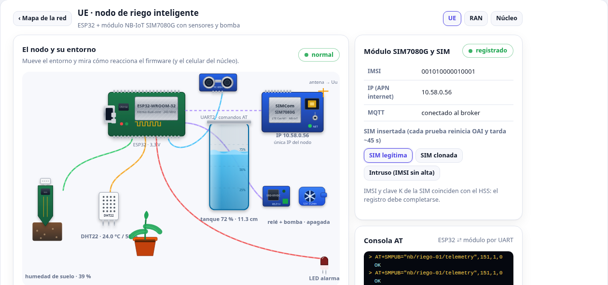

# Narrowcast-NB

**A private NB-IoT cellular network built from open-source software and low-cost hardware, with an interactive laboratory to see how it works.** A sensor with an NB-IoT module attaches over radio to your own base station and your own core network, with no operator involved, and its data shows up in a web control panel. The same network also runs without any radio: a virtual node registers through the real eNB and core, and you can open every layer.

```
ESP32 ──UART (AT)── NB-IoT module ~~ radio ~~ USRP (eNB) ── Ethernet ── PC (Open5GS core) ── MQTT ── Web panel
```

NB-IoT is the 3GPP low-power wide-area technology made for sensors that run for years on a battery. This project stands up **every element of that chain** (device, base station, core network, message broker and operations UI), so you can see, measure and break a real cellular IoT network end to end: SIM authentication, IP assignment, data transport, power saving and safe radio operation.

> Most cellular IoT demos hide the network behind an operator. This one puts the whole network on your desk, shows what each part is doing, and is honest about what is real and what is simulated.

<p align="center">
  <br>
  <sub><b>The laboratory running:</b> an irrigation node registered through the real OAI eNB, with a telemetry packet travelling through the GTP-U tunnel to the broker and the phone.</sub>
</p>

## The real network

- **Real attach procedure.** SIM authentication in the HSS (Milenage), NAS security, session creation and an IP address from a private subnet, using the unmodified Open5GS EPC (MME, HSS, SGW-C/U, PGW-C/U, PCRF, MongoDB).
- **Open-source NB-IoT base station.** OpenAirInterface (`develop-nb-iot`) driving a USRP, in an Ubuntu 16.04 container because the branch does not build on newer systems, with a one-line fix to its S1AP decoder so it completes the attach against Open5GS. Band, frequency and gain come from the RF plan.
- **Telemetry up, commands down.** Temperature, humidity and signal quality flow from an ESP32 with a SIM7080G or BG96 module over MQTT to the panel; commands (LED, report interval, pump) flow back.
- **RF safety by design.** Radio is off by default. It only turns on with a validated plan, written authorisation, limited gain and a maximum duration, with a press-and-hold transmit button, automatic cut-off and a log of every session.
- **Operations panel.** Subscriber management in the HSS, animated network map, live container logs, device data and the RF plan, in a FastAPI + React panel.
- **Reproducible.** Everything runs in Docker Compose on its own network (`10.44.0.0/24`), with pinned upstream versions.

| Layer | Solution |
|---|---|
| Device | ESP32 with an NB-IoT module (SIM7080G or BG96) driven by AT commands; MQTT. |
| Radio (eNB) | USRP with OpenAirInterface (`develop-nb-iot`). |
| Core (EPC) | Open5GS v2.7.5, with MongoDB for subscribers. |
| Data | Mosquitto with user and password; topics `nb/<id>/telemetry`, `cmd` and `status`. |
| Operations | Web panel (FastAPI, React + TypeScript) over Docker, MQTT and the RF plan. |
| RF safety | Plan validated by script and by the panel before any transmission; sessions recorded in a CSV. |

Network parameters: PLMN `001/01`, TAC `1`, APN `internet`, UE subnet `10.58.0.0/16`. Real transmission needs a USRP, a module with a SIM and written authorisation for the band and power; the step-by-step path is in [`docs/operacion/puesta-en-marcha.md`](docs/operacion/puesta-en-marcha.md).

## The laboratory: learn it and test it without radio

An irrigation node (ESP32, SIM7080G module, soil, temperature, tank-level and distance sensors, pump) registers through the **real OAI eNB** using a fake radio, then sends **real MQTT through the GTP-U tunnel** of OAI and the core. It needs no USRP and emits nothing, so it is the safest way to understand the network before touching RF.

- **Watch a real attach, step by step**, with each message animated across the layers it crosses and contrasted with what the core logged.
- **Open the UE.** Firmware as C code with the running function highlighted, the module's AT console, and sensors you can move. The pump reacts.
- **Open the RAN.** The OAI protocol stack (S1AP, RRC, PDCP, RLC, MAC, PHY, GTP-U) with its real log and its **NB-IoT radio parameters**: band, DL/UL, EARFCN, host carrier, NPRACH, NPDCCH, paging, gain.
- **Change the radio and see the consequences.** Another band, or the node farther from the eNB: signal level, coverage level (CE0/1/2), repetitions, latency, energy, a band the module does not support, or no coverage. Parameters are really loaded by OAI (the eNB restarts); the effects are a labelled model.
- **Open the core**, with its real interfaces and a minimal phone that subscribes to MQTT and commands the node.
- **Follow the user plane:** per-message UPF byte counters prove each packet crossed the core.
- **Break it on purpose:** cloned SIM, intruder and detach, each against the real HSS and MME.

<p align="center">
  <br>
  <sub><b>Inside the UE:</b> sensors you can move, a pump that reacts, the module's registration state and its AT console.</sub>
</p>

<p align="center">
  <br>
  <sub><b>User-plane log:</b> the control-plane log stays empty for data, so each message is backed by the UPF packet and byte counters.</sub>
</p>

## Real and simulated, stated plainly

| | Real network (with USRP) | Laboratory (no radio) |
|---|---|---|
| **Core** | Open5GS, unmodified | The same, unmodified |
| **eNB** | OAI with a USRP, emitting RF | OAI's RRC, S1AP, GTP-U and MAC, with a fake radio and an injector; one simulated random access per start |
| **NAS and data** | Real, over the air | Real: Milenage, EIA2, MQTT through the GTP-U tunnel with an IP from the PGW-C |
| **Radio parameters** | Written to OAI's configuration | The same, loaded when the eNB starts |
| **Radio effects** | Physical | **Modelled**, not measured: path loss, RSRP, coverage level, repetitions, latency, energy |
| **Device** | ESP32 and module, real | ESP32 logic reproduced in Python (C code shown, not run); sensors are sliders |

The lab exercises the software of the network, not the physical layer.

## Quick start

Requires Docker with Compose v2 and about 10 GB of free disk.

```bash
git clone https://github.com/franco0209/Narrowcast-NB.git
cd Narrowcast-NB
cp .env.example .env                              # change at least MQTT_PASS
docker compose up -d                              # core + broker + panel (no radio emission)
docker compose --profile oailab create oai-lab    # once: the fake-radio eNB container (laboratory)
```

Open the panel at <http://127.0.0.1:8080> and the Open5GS WebUI at <http://127.0.0.1:9999>. To try the laboratory, open its tab and press **Registrar nodo** (about 45 s). For real radio, follow the RF plan and [`docs/operacion/puesta-en-marcha.md`](docs/operacion/puesta-en-marcha.md).

Other useful commands:

```bash
docker compose ps                                    # every service "running"
docker logs -f nb-mme                                # any nb-* container
docker compose exec app python fake_device.py esp32-sim   # synthetic telemetry
docker compose --profile sim up -d && scripts/validate.sh # virtual radio: attach + ping through the tunnel
docker compose down                                  # stop, keeping data
docker compose down -v                               # stop and delete subscribers
```

If the core shows fewer services than expected, check `docker compose ps -a`: the HSS, PCRF and WebUI restart in a loop while `nb-mongo` is down.

## Control panel

A web UI at <http://127.0.0.1:8080> that follows the system light/dark theme.

- **Laboratory:** the irrigation node on real OAI and Open5GS, as described above.
- **Summary:** animated map of the network (ESP32 → eNB → MME/SGW/PGW → Mosquitto → panel); click a node for its role, interfaces and logs.
- **Subscribers:** create, edit, delete and CSV-import SIMs (IMSI, K, OPc, AMF, APN) directly in the HSS database. K and OPc are never displayed.
- **Core:** animated EPC architecture with real interfaces, ports and parameters, and the attach procedure replayable step by step.
- **eNB (OAI):** the eNB protocol stack (S1AP/GTP-U, RRC, PDCP, RLC, MAC, NB-IoT PHY, UHD) with downlink and uplink paths, start-up sequence, parameters taken from the RF plan and the live log.
- **Radio:** the RF plan with safe defaults and a transmit button that requires a valid plan, two human confirmations (free carrier, authorised by) and press-and-hold; it cuts off when the maximum duration is reached.
- **Device:** latest reading, history chart, and commands to the node.
- **Help:** built-in guides for radio, module, data and the lab.

## Modules

| Module | Location | Role |
|---|---|---|
| Open5GS core | `config/open5gs/`, `docker/open5gs/`, `docker/webui/` | Full EPC and WebUI (port 9999) to register SIMs. |
| Subscriber provisioning | `provisioning/` | Loads the test subscriber into MongoDB at start-up. |
| NB-IoT eNB | `docker/oai-nbiot/`, `config/oai/`, `scripts/oai-enb-start.sh` | OAI image and eNB start-up, with band, frequency and gain taken from the RF plan. |
| Virtual radio | `config/srsran/`, `docker/srsran4g/`, `scripts/sim.sh`, `scripts/validate.sh` | Simulated eNB and UE (srsRAN 4G) to validate the core without emitting RF. |
| RF rules | `rf-plan.example.yaml`, `scripts/rf-check.sh`, `scripts/rf-run.sh` | Plan validation, automatic cut-off by duration and session log. |
| MQTT broker | `mosquitto/` | Messaging between the device and the panel. |
| Control panel | `app/` | FastAPI backend and React frontend (`app/web/`), plus a device simulator (`fake_device.py`). |
| **Laboratory** | `app/simlab/`, `app/web/src/lab/`, `lab/oai-fakerf/` | The didactic core of the project: irrigation node simulator, NAS engine, radio model, fake-radio and injector hooks for OAI, and the UE/RAN/Core views. |
| Firmware | `firmware/esp32-nbiot/` | ESP32 code (Arduino/PlatformIO): modem over AT, DHT22 sensor, LED and MQTT. |
| Documentation | `docs/` | Concepts, operation, architecture, laboratory and project status. |

## Project layout

```
compose.yaml            services (profile `sim` = virtual radio, `radio` = NB-IoT eNB, `oailab` = lab eNB)
.env.example            variables (copy to .env)
rf-plan.example.yaml    RF plan template (stored as data/rf-plan.yaml)
config/                 Open5GS, srsRAN and OAI configuration
provisioning/           subscriber provisioning in MongoDB
app/                    control panel (FastAPI + React/TypeScript in app/web/), device simulator, simlab/ (lab)
lab/oai-fakerf/         fake radio, injector and downlink relay hooks for OAI
mosquitto/              MQTT broker configuration
firmware/               ESP32 code
data/                   RF plan and session log (not versioned)
docker/                 Dockerfiles (open5gs, srsran4g, webui, oai-nbiot)
scripts/                sim.sh, validate.sh, rf-check.sh, rf-run.sh, oai-enb-start.sh, oai-lab-start.sh
docs/                   documentation, organised by topic
```

`.env`, `data/`, `firmware/**/secrets.h` and `.pcap` files are not versioned.

## Documentation

Everything is in [`docs/`](docs/README.md), organised by topic (documents are written in Spanish):

| Topic | Document |
|---|---|
| Concepts | [`introduccion.md`](docs/conceptos/introduccion.md) (start here), [`fundamentos.md`](docs/conceptos/fundamentos.md): NB-IoT, EPC, SIM, SDR, glossary, exercises |
| Operation | [`puesta-en-marcha.md`](docs/operacion/puesta-en-marcha.md), [`docker-y-compilacion.md`](docs/operacion/docker-y-compilacion.md), [`panel.md`](docs/operacion/panel.md), [`seguridad-rf.md`](docs/operacion/seguridad-rf.md), [`preguntas-frecuentes.md`](docs/operacion/preguntas-frecuentes.md) |
| Architecture | [`vision-general.md`](docs/arquitectura/vision-general.md), [`open5gs.md`](docs/arquitectura/open5gs.md), [`oai.md`](docs/arquitectura/oai.md), [`integracion.md`](docs/arquitectura/integracion.md), [`modificaciones-oai-open5gs.md`](docs/arquitectura/modificaciones-oai-open5gs.md) (what was changed in Open5GS and OAI, and what was not), [`codigo-propio.md`](docs/arquitectura/codigo-propio.md) |
| Laboratory | [`implementacion.md`](docs/laboratorio/implementacion.md), [`radio-nbiot.md`](docs/laboratorio/radio-nbiot.md), [`pruebas-oai.md`](docs/laboratorio/pruebas-oai.md) |
| Project | [`plan.md`](docs/proyecto/plan.md), [`estado.md`](docs/proyecto/estado.md) (status and verification) |

## Tech

Open5GS v2.7.5, OpenAirInterface (`develop-nb-iot`), srsRAN 4G, Mosquitto, MongoDB, FastAPI, React 18, TypeScript, Vite, framer-motion, Docker Compose, ESP32 (Arduino, TinyGSM, PubSubClient).

## Data and attribution

Open5GS is AGPL-3.0, OpenAirInterface is under the OAI Public License v1.0, and srsRAN 4G is AGPL-3.0; this repository contains only configuration, build files and the project's own code, and builds those projects from their upstream sources at pinned commits.

## License

MIT
