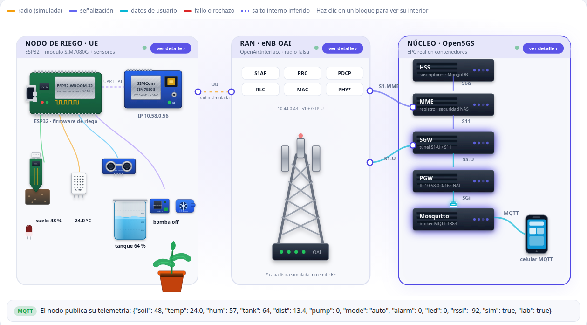

# Narrowcast-NB

**An interactive laboratory to see how a cellular IoT network really works.** A virtual NB-IoT irrigation node registers through a **real OpenAirInterface eNB** into a **real Open5GS core**, and sends MQTT through the actual GTP-U tunnel. You can open the device, the base station and the core, move the sensors, change the radio, and watch every message cross every layer.

```
ESP32 + SIM7080G ~~ Uu (simulated) ~~ OAI eNB ── S1 ── Open5GS EPC ── MQTT broker ── phone / panel
   (UE)                                 (RAN)               (Core)
```

Most cellular IoT demos hide the network behind an operator. This one puts the whole network on your screen, explains what each part is doing, and is honest about what is real and what is simulated. The orchestration of OAI and Open5GS is the foundation; **the teaching lab on top of it is the point of the project.** The same stack can also drive a real USRP and a real NB-IoT module (see [Beyond the lab](#beyond-the-lab-real-radio)).

<p align="center">
  <br>
  <sub><b>The lab running:</b> an irrigation node registered through the real OAI eNB, with a telemetry packet travelling through the GTP-U tunnel to the broker and the phone.</sub>
</p>

## What you can do in the lab

- **Watch a real attach, step by step.** SIM authentication in the HSS (Milenage), NAS security, session creation and an IP address, with each message animated across the layers it really crosses and contrasted with what the core logged.
- **Open the UE.** ESP32 firmware shown as C code with the running function highlighted, the SIM7080G module with an AT console, and sensors you can move: soil moisture, temperature, tank level, a hand in front of the ultrasonic sensor. The pump reacts.
- **Open the RAN.** The OAI eNB protocol stack (S1AP, RRC, PDCP, RLC, MAC, PHY, GTP-U) with the real log, and its **NB-IoT radio parameters**: band, DL/UL, EARFCN, host carrier, NPRACH, NPDCCH, paging, gain.
- **Change the radio and see the consequences.** Pick another band or move the node away from the eNB: signal level (RSRP), coverage level (CE0/1/2) and repetitions, extra latency from random access and paging, energy per message, a band the module does not support, or no coverage at all. Parameters are really loaded by OAI (the eNB restarts); the consequences are a labelled model.
- **Open the core.** Open5GS (MME, HSS, SGW-C/U, PGW-C/U, PCRF) with its real interfaces, plus a minimal phone that subscribes to MQTT and commands the node.
- **Follow the user plane.** MQTT and ping travel UE → OAI → GTP-U → SGW-U → PGW-U → broker, and per-message UPF byte counters prove each packet crossed the core.
- **Break it on purpose.** Cloned SIM, intruder and detach, each run against the real HSS and MME.

<p align="center">
  <br>
  <sub><b>Inside the UE:</b> sensors you can move, a pump that reacts, the module's registration state and its AT console.</sub>
</p>

<p align="center">
  <br>
  <sub><b>User-plane log:</b> the control-plane log stays empty for data, so each message is backed by the UPF packet and byte counters.</sub>
</p>

## Real and simulated, stated plainly

| Part | In the lab |
|---|---|
| **Core** | Real. Open5GS v2.7.5 (MME, HSS, SGW, PGW, PCRF, MongoDB), unmodified. |
| **RAN** | Real software. OAI RRC, S1AP, GTP-U and MAC, with a one-line fix to its S1AP decoder so it completes the attach against Open5GS. The radio is a fake device and an injector, and one simulated random access per eNB start. |
| **NAS and data** | Real. Milenage, EIA2, Security Mode, and MQTT through the GTP-U tunnel with an IP from the PGW-C. |
| **Radio parameters** | Real: they are written into OAI's configuration and loaded when the eNB starts. |
| **Radio effects** | **Modelled**, not measured: path loss, RSRP, coverage level, repetitions, latency, energy. There is no signal to degrade, so these are computed and applied to the simulated node. |
| **UE** | The ESP32 firmware logic is reproduced in Python (the C code is shown, not run); sensors are sliders. |

The lab exercises the software of the network, not the physical layer.

## Quick start

Requires Docker with Compose v2 and about 10 GB of free disk.

```bash
git clone https://github.com/franco0209/Narrowcast-NB.git
cd Narrowcast-NB
cp .env.example .env                              # change at least MQTT_PASS
docker compose up -d                              # core + broker + panel (no radio emission)
docker compose --profile oailab create oai-lab    # once: the fake-radio eNB container
```

Open the panel at <http://127.0.0.1:8080>, go to the **Laboratorio** tab and press **Registrar nodo** (about 45 s: the eNB starts and settles before the node registers). The Open5GS WebUI is at <http://127.0.0.1:9999>.

Other useful commands:

```bash
docker compose ps                                    # every service "running"
docker logs -f nb-mme                                # any nb-* container
docker compose --profile sim up -d && scripts/validate.sh # virtual radio: attach + ping through the tunnel
docker compose down                                  # stop, keeping data
docker compose down -v                               # stop and delete subscribers
```

If the core shows fewer services than expected, check `docker compose ps -a`: the HSS, PCRF and WebUI restart in a loop while `nb-mongo` is down. Step-by-step setup is in [`docs/operacion/puesta-en-marcha.md`](docs/operacion/puesta-en-marcha.md).

## Beyond the lab: real radio

The same network can carry a real device. With a USRP, an NB-IoT module with a SIM and written authorisation for the band and power, an ESP32 attaches over radio to your own base station and core, with no operator involved, and its data shows up in the panel.

```
ESP32 ──UART (AT)── NB-IoT module ~~ radio ~~ USRP (eNB) ── Ethernet ── PC (Open5GS core) ── MQTT ── Web panel
```

- **RF safety by design.** Radio is off by default. It only turns on with a validated plan, written authorisation, limited gain and a maximum duration, and every session is logged.
- **Real eNB.** OpenAirInterface (`develop-nb-iot`) in an Ubuntu 16.04 container, since the branch does not build on newer systems; band, frequency and gain come from the RF plan.
- **Telemetry up, commands down.** Temperature, humidity and signal quality flow from the ESP32 over MQTT; commands (LED, report interval, pump) flow back.

| Layer | Solution |
|---|---|
| Device | ESP32 with an NB-IoT module (SIM7080G or BG96) driven by AT commands; MQTT. |
| Radio (eNB) | USRP with OpenAirInterface (`develop-nb-iot`). |
| Core (EPC) | Open5GS v2.7.5, with MongoDB for subscribers. |
| Data | Mosquitto with user and password; topics `nb/<id>/telemetry`, `cmd` and `status`. |
| Operations | Web panel (FastAPI, React + TypeScript) over Docker, MQTT and the RF plan. |
| Deployment | Docker Compose on its own network (`10.44.0.0/24`), `nb-*` containers, pinned upstream versions. |

Network parameters: PLMN `001/01`, TAC `1`, APN `internet`, UE subnet `10.58.0.0/16`. The real-radio path is described in [`docs/operacion/puesta-en-marcha.md`](docs/operacion/puesta-en-marcha.md).

## Control panel

A web UI at <http://127.0.0.1:8080> that follows the system light/dark theme.

- **Laboratory:** the irrigation node on real OAI and Open5GS, as described above.
- **Summary:** animated map of the network (ESP32 → eNB → MME/SGW/PGW → Mosquitto → panel); click a node for its role, interfaces and logs.
- **Subscribers:** create, edit, delete and CSV-import SIMs (IMSI, K, OPc, AMF, APN) directly in the HSS database. K and OPc are never displayed.
- **Core:** animated EPC architecture with real interfaces, ports and parameters, and the attach procedure replayable step by step.
- **eNB (OAI):** the eNB protocol stack (S1AP/GTP-U, RRC, PDCP, RLC, MAC, NB-IoT PHY, UHD) with downlink and uplink paths, start-up sequence, parameters taken from the RF plan and the live log.
- **Radio:** the RF plan with safe defaults and a transmit button that requires a valid plan, two human confirmations (free carrier, authorised by) and press-and-hold; it cuts off when the maximum duration is reached.
- **Device:** latest reading, history chart, and commands to the node.
- **Help:** built-in guides for radio, module, data and the lab.

## Modules

| Module | Location | Role |
|---|---|---|
| Open5GS core | `config/open5gs/`, `docker/open5gs/`, `docker/webui/` | Full EPC and WebUI (port 9999) to register SIMs. |
| Subscriber provisioning | `provisioning/` | Loads the test subscriber into MongoDB at start-up. |
| NB-IoT eNB | `docker/oai-nbiot/`, `config/oai/`, `scripts/oai-enb-start.sh` | OAI image and eNB start-up, with band, frequency and gain taken from the RF plan. |
| Virtual radio | `config/srsran/`, `docker/srsran4g/`, `scripts/sim.sh`, `scripts/validate.sh` | Simulated eNB and UE (srsRAN 4G) to validate the core without emitting RF. |
| RF rules | `rf-plan.example.yaml`, `scripts/rf-check.sh`, `scripts/rf-run.sh` | Plan validation, automatic cut-off by duration and session log. |
| MQTT broker | `mosquitto/` | Messaging between the device and the panel. |
| Control panel | `app/` | FastAPI backend and React frontend (`app/web/`), plus a device simulator (`fake_device.py`). |
| **Laboratory** | `app/simlab/`, `app/web/src/lab/`, `lab/oai-fakerf/` | The didactic core of the project: irrigation node simulator, NAS engine, radio model, fake-radio and injector hooks for OAI, and the UE/RAN/Core views. |
| Firmware | `firmware/esp32-nbiot/` | ESP32 code (Arduino/PlatformIO): modem over AT, DHT22 sensor, LED and MQTT. |
| Documentation | `docs/` | Project, concepts, architecture, operation, laboratory and reference. |

## Project layout

```
compose.yaml            services (profile `sim` = virtual radio, `radio` = NB-IoT eNB, `oailab` = lab eNB)
.env.example            variables (copy to .env)
rf-plan.example.yaml    RF plan template (stored as data/rf-plan.yaml)
config/                 Open5GS, srsRAN and OAI configuration
provisioning/           subscriber provisioning in MongoDB
app/                    control panel (FastAPI + React/TypeScript in app/web/), device simulator, simlab/ (lab)
lab/oai-fakerf/         fake radio, injector and downlink relay hooks for OAI
mosquitto/              MQTT broker configuration
firmware/               ESP32 code
data/                   RF plan and session log (not versioned)
docker/                 Dockerfiles (open5gs, srsran4g, webui, oai-nbiot)
scripts/                sim.sh, validate.sh, rf-check.sh, rf-run.sh, oai-enb-start.sh, oai-lab-start.sh
docs/                   documentation, organised by topic
```

`.env`, `data/`, `firmware/**/secrets.h` and `.pcap` files are not versioned.

## Documentation

Everything is in [`docs/`](docs/README.md), organised by topic (documents are written in Spanish):

| Topic | Document |
|---|---|
| Project | [`plan.md`](docs/proyecto/plan.md), [`estado-por-fases.md`](docs/proyecto/estado-por-fases.md) |
| Concepts | [`fundamentos.md`](docs/conceptos/fundamentos.md): NB-IoT, EPC, SIM, SDR, glossary |
| Architecture | [`arquitectura.md`](docs/arquitectura/arquitectura.md), [`integracion-oai-open5gs.md`](docs/arquitectura/integracion-oai-open5gs.md), [`codigo-por-dentro.md`](docs/arquitectura/codigo-por-dentro.md), [`modificaciones-oai-open5gs.md`](docs/arquitectura/modificaciones-oai-open5gs.md) (what was changed in Open5GS and OAI, and what was not) |
| Operation | [`puesta-en-marcha.md`](docs/operacion/puesta-en-marcha.md), [`docker-y-compilacion.md`](docs/operacion/docker-y-compilacion.md), [`panel.md`](docs/operacion/panel.md) |
| Laboratory | [`implementacion.md`](docs/laboratorio/implementacion.md), [`pruebas-oai.md`](docs/laboratorio/pruebas-oai.md) |
| Reference | [`verificacion.md`](docs/referencia/verificacion.md), [`preguntas-recurrentes.md`](docs/referencia/preguntas-recurrentes.md) |

## Tech

Open5GS v2.7.5, OpenAirInterface (`develop-nb-iot`), srsRAN 4G, Mosquitto, MongoDB, FastAPI, React 18, TypeScript, Vite, framer-motion, Docker Compose, ESP32 (Arduino, TinyGSM, PubSubClient).

## Data and attribution

Open5GS is AGPL-3.0, OpenAirInterface is under the OAI Public License v1.0, and srsRAN 4G is AGPL-3.0; this repository contains only configuration, build files and the project's own code, and builds those projects from their upstream sources at pinned commits.

## License

MIT
