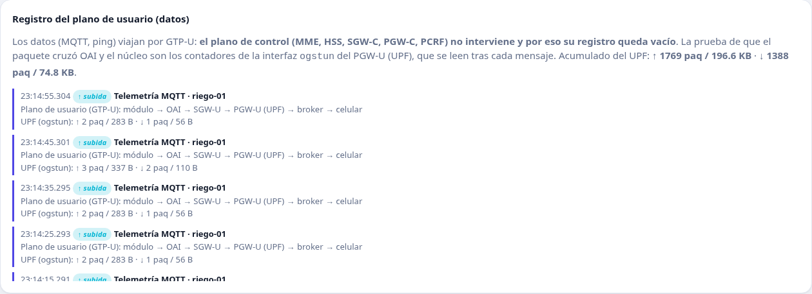

# Narrowcast-NB

A private NB-IoT cellular network built entirely from open-source software and low-cost hardware.
A sensor with an NB-IoT module attaches over radio to your own base station and your own core network, with no operator involved, and its data shows up in a web control panel.

```
ESP32 ──UART (AT)── NB-IoT module ~~ radio ~~ USRP (eNB) ── Ethernet ── PC (Open5GS core) ── MQTT ── Web panel
```

NB-IoT is the 3GPP low-power wide-area technology made for sensors that run for years on a battery. This project stands up **every element of that chain** (device, base station, core network, message broker and operations UI), so you can see, measure and break a real cellular IoT network end to end: SIM authentication, IP assignment, data transport, power saving and safe radio operation.

> Most cellular IoT demos hide the network behind an operator. This one puts the whole network on your desk, shows what each part is doing, and is honest about what is real and what is simulated.

<p align="center">
  <br>
  <sub><b>The lab running:</b> an irrigation node registered through the real OAI eNB, with a telemetry packet travelling through the GTP-U tunnel to the broker and the phone.</sub>
</p>

## Features

- **Real attach procedure.** SIM authentication in the HSS (Milenage), NAS security, session creation and an IP address from a private subnet, using the unmodified Open5GS EPC.
- **Open-source NB-IoT base station.** OpenAirInterface (`develop-nb-iot` branch), run in a container with a one-line fix to its S1AP decoder so it can complete the attach against Open5GS.
- **Telemetry up, commands down.** Temperature, humidity and signal quality flow from an ESP32 over MQTT to the panel; commands (LED, report interval, pump) flow back.
- **RF safety by design.** Radio is off by default. It only turns on with a validated plan, written authorisation, limited gain and a maximum duration, and every session is logged.
- **Live control panel.** Animated network map, subscriber management, step-by-step attach replay, per-layer eNB view, live container logs and device data.
- **A lab that needs no radio.** An irrigation node (ESP32, SIM7080G module, soil, temperature, tank-level and distance sensors, pump) registers through the **real OAI eNB** using a fake radio, then sends **real MQTT through the GTP-U tunnel** of OAI and the core. Open the UE, the RAN or the core to see what runs inside each one.
- **Attack scenarios.** Cloned SIM, intruder and detach, each run against the real HSS and MME.
- **Reproducible.** Everything runs in Docker Compose on its own network, with pinned upstream versions.

## The lab at a glance

The Laboratory tab of the panel runs a complete node on top of real software. Only the radio interface (Uu) is simulated:

| Part | What it is |
|---|---|
| **UE (the node)** | ESP32 firmware shown as highlighted C code, SIM7080G module with an AT console, interactive sensors (move the soil or tank level, put a hand in front of the ultrasonic sensor) and a pump that reacts. |
| **RAN** | The OAI eNB: RRC, S1AP, GTP-U and MAC are the real ones, driven through a fake radio and an injector. |
| **Core** | Open5GS (MME, HSS, SGW-C/U, PGW-C/U, PCRF) plus a minimal phone that subscribes to MQTT and can command the node. |
| **User plane** | MQTT and ping travel UE → OAI → GTP-U → SGW-U → PGW-U → broker. Per-message byte counters from the UPF show that each packet really crossed the core. |

<p align="center">
  <br>
  <sub><b>Inside the UE:</b> sensors you can move, a pump that reacts, the module's registration state and its AT console.</sub>
</p>

<p align="center">
  <br>
  <sub><b>User-plane log:</b> the control-plane log stays empty for data, so each message is backed by the UPF packet and byte counters.</sub>
</p>

## How it works

| Layer | Solution |
|---|---|
| Device | ESP32 with an NB-IoT module (SIM7080G or BG96) driven by AT commands; publishes and subscribes over MQTT. |
| Radio (eNB) | USRP with OpenAirInterface (`develop-nb-iot`), the open-source NB-IoT implementation for the base station. Runs on Ubuntu 16.04 in a container, since the branch does not build on newer systems. |
| Core (EPC) | Open5GS v2.7.5: MME, HSS, SGW-C/U, PGW-C/U and PCRF, with MongoDB for subscribers. |
| Data | Mosquitto MQTT broker with user and password; topics `nb/<id>/telemetry`, `cmd` and `status`. |
| Operations | Web panel (FastAPI backend, React + TypeScript frontend) that talks to Docker, MQTT and the RF plan. |
| Deployment | Docker Compose, with its own network (`10.44.0.0/24`) and `nb-*` containers. |
| RF safety | An RF plan validated by script and by the panel before any transmission; sessions recorded in a CSV. |

Network parameters: PLMN `001/01`, TAC `1`, APN `internet`, UE subnet `10.58.0.0/16`.

## Quick start

Requires Docker with Compose v2 and about 10 GB of free disk.

```bash
git clone https://github.com/franco0209/Narrowcast-NB.git
cd Narrowcast-NB
cp .env.example .env          # change at least MQTT_PASS
docker compose up -d          # core + broker + panel (no radio emission)
```

Open the panel at <http://127.0.0.1:8080>. The Open5GS WebUI is at <http://127.0.0.1:9999>.

To try the Laboratory (no hardware needed):

```bash
docker compose --profile oailab create oai-lab   # once: the fake-radio eNB container
```

Then open the **Laboratorio** tab and press **Registrar nodo** (about 45 s: the eNB starts and settles before the node registers).

Other useful commands:

```bash
docker compose ps                                    # every service "running"
docker logs -f nb-mme                                # any nb-* container
docker compose exec app python fake_device.py esp32-sim   # synthetic telemetry
docker compose --profile sim up -d && scripts/validate.sh # virtual radio: attach + ping through the tunnel
docker compose --profile sim --profile radio down    # stop, keeping data
docker compose down -v                               # stop and delete subscribers
```

Step-by-step setup, including the real-radio path, is in [`docs/operacion/puesta-en-marcha.md`](docs/operacion/puesta-en-marcha.md).

## Control panel

A web UI at <http://127.0.0.1:8080> that follows the system light/dark theme.

- **Summary:** animated map of the network (ESP32 → eNB → MME/SGW/PGW → Mosquitto → panel); click a node for its role, interfaces and logs.
- **Subscribers:** create, edit, delete and CSV-import SIMs (IMSI, K, OPc, AMF, APN) directly in the HSS database. K and OPc are never displayed.
- **Core:** animated EPC architecture with real interfaces, ports and parameters, and the attach procedure replayable step by step.
- **eNB (OAI):** the eNB protocol stack (S1AP/GTP-U, RRC, PDCP, RLC, MAC, NB-IoT PHY, UHD) with downlink and uplink paths, start-up sequence, parameters taken from the RF plan and the live log.
- **Radio:** the RF plan with safe defaults and a transmit button that requires a valid plan, two human confirmations (free carrier, authorised by) and press-and-hold; it cuts off when the maximum duration is reached.
- **Device:** latest reading, history chart, and commands to the node.
- **Laboratory:** the irrigation node on real OAI and Open5GS, as described above.
- **Help:** built-in guides for radio, module, data and the lab.

## Modules

| Module | Location | Role |
|---|---|---|
| Open5GS core | `config/open5gs/`, `docker/open5gs/`, `docker/webui/` | Full EPC and WebUI (port 9999) to register SIMs. |
| Subscriber provisioning | `provisioning/` | Loads the test subscriber into MongoDB at start-up. |
| NB-IoT eNB | `docker/oai-nbiot/`, `config/oai/`, `scripts/oai-enb-start.sh` | OAI image and eNB start-up, with band, frequency and gain taken from the RF plan. |
| Virtual radio | `config/srsran/`, `docker/srsran4g/`, `scripts/sim.sh`, `scripts/validate.sh` | Simulated eNB and UE (srsRAN 4G) to validate the core without emitting RF. |
| RF rules | `rf-plan.example.yaml`, `scripts/rf-check.sh`, `scripts/rf-run.sh` | Plan validation, automatic cut-off by duration and session log. |
| MQTT broker | `mosquitto/` | Messaging between the device and the panel. |
| Control panel | `app/` | FastAPI backend and React frontend (`app/web/`), plus a device simulator (`fake_device.py`). |
| Laboratory | `app/simlab/`, `app/web/src/lab/`, `lab/oai-fakerf/` | Irrigation node simulator, NAS engine, fake-radio and injector hooks for OAI, and the UE/RAN/Core views. |
| Firmware | `firmware/esp32-nbiot/` | ESP32 code (Arduino/PlatformIO): modem over AT, DHT22 sensor, LED and MQTT. |
| Documentation | `docs/` | Project, concepts, architecture, operation, laboratory and reference. |

## What is real and what is simulated

| Real | Simulated |
|---|---|
| Open5GS EPC (MME, HSS, SGW, PGW, PCRF, MongoDB) | The radio interface (Uu) in the lab: there is no modulation, power or coverage |
| OAI RRC, S1AP, GTP-U and MAC | One simulated random access per eNB start in the lab |
| NAS: Milenage, EIA2, Security Mode | The ESP32 electronics (its logic is reproduced, not the hardware) |
| MQTT data through the GTP-U tunnel and IP from the PGW-C | Sensor readings (moved with sliders) |

The lab exercises the software of the network, not the physical layer. Real NB-IoT transmission needs a USRP, a module with a SIM and written authorisation for the band and power, and is guarded by the RF safety rules above.

## Project layout

```
compose.yaml            services (profile `sim` = virtual radio, `radio` = NB-IoT eNB, `oailab` = lab eNB)
.env.example            variables (copy to .env)
rf-plan.example.yaml    RF plan template (stored as data/rf-plan.yaml)
config/                 Open5GS, srsRAN and OAI configuration
provisioning/           subscriber provisioning in MongoDB
app/                    control panel (FastAPI + React/TypeScript in app/web/), device simulator, simlab/ (lab)
lab/oai-fakerf/         fake radio, injector and downlink relay hooks for OAI
mosquitto/              MQTT broker configuration
firmware/               ESP32 code
data/                   RF plan and session log (not versioned)
docker/                 Dockerfiles (open5gs, srsran4g, webui, oai-nbiot)
scripts/                sim.sh, validate.sh, rf-check.sh, rf-run.sh, oai-enb-start.sh, oai-lab-start.sh
docs/                   documentation, organised by topic
```

`.env`, `data/`, `firmware/**/secrets.h` and `.pcap` files are not versioned.

## Documentation

Everything is in [`docs/`](docs/README.md), organised by topic (documents are written in Spanish):

| Topic | Document |
|---|---|
| Project | [`plan.md`](docs/proyecto/plan.md), [`estado-por-fases.md`](docs/proyecto/estado-por-fases.md) |
| Concepts | [`fundamentos.md`](docs/conceptos/fundamentos.md): NB-IoT, EPC, SIM, SDR, glossary |
| Architecture | [`arquitectura.md`](docs/arquitectura/arquitectura.md), [`integracion-oai-open5gs.md`](docs/arquitectura/integracion-oai-open5gs.md), [`codigo-por-dentro.md`](docs/arquitectura/codigo-por-dentro.md), [`modificaciones-oai-open5gs.md`](docs/arquitectura/modificaciones-oai-open5gs.md) (what was changed in Open5GS and OAI, and what was not) |
| Operation | [`puesta-en-marcha.md`](docs/operacion/puesta-en-marcha.md), [`docker-y-compilacion.md`](docs/operacion/docker-y-compilacion.md), [`panel.md`](docs/operacion/panel.md) |
| Laboratory | [`implementacion.md`](docs/laboratorio/implementacion.md), [`pruebas-oai.md`](docs/laboratorio/pruebas-oai.md) |
| Reference | [`verificacion.md`](docs/referencia/verificacion.md), [`preguntas-recurrentes.md`](docs/referencia/preguntas-recurrentes.md) |

## Tech

Open5GS v2.7.5, OpenAirInterface (`develop-nb-iot`), srsRAN 4G, Mosquitto, MongoDB, FastAPI, React 18, TypeScript, Vite, framer-motion, Docker Compose, ESP32 (Arduino, TinyGSM, PubSubClient).

## Data and attribution

Open5GS is AGPL-3.0, OpenAirInterface is under the OAI Public License v1.0, and srsRAN 4G is AGPL-3.0; this repository contains only configuration, build files and the project's own code, and builds those projects from their upstream sources at pinned commits.

## License

MIT
